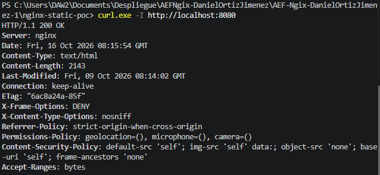
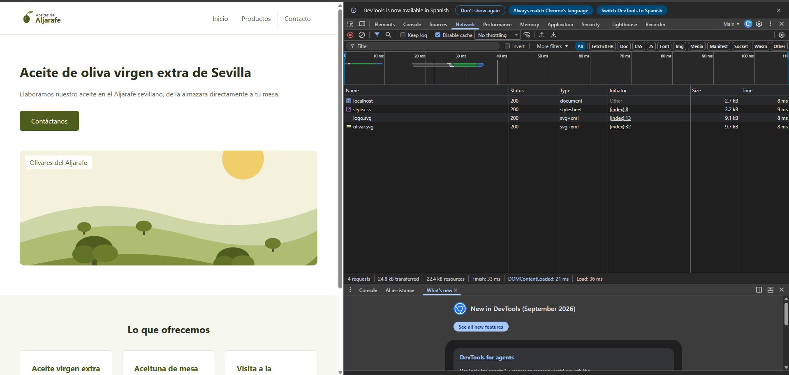
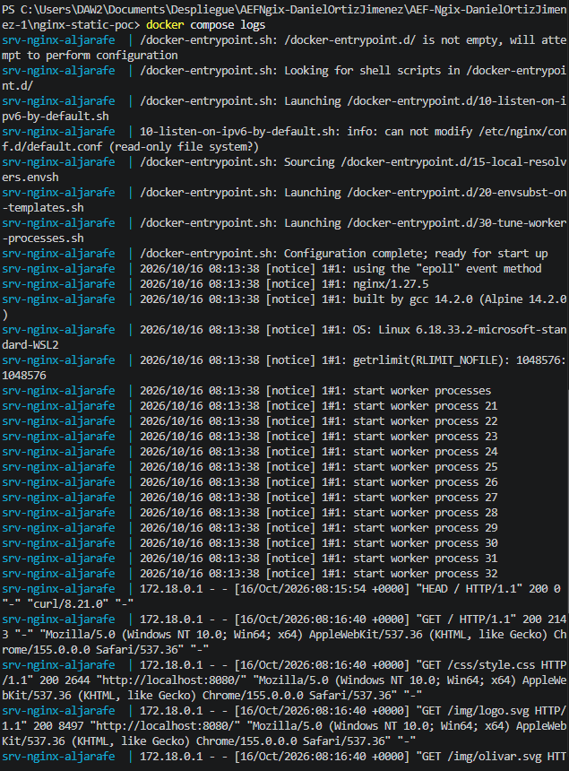
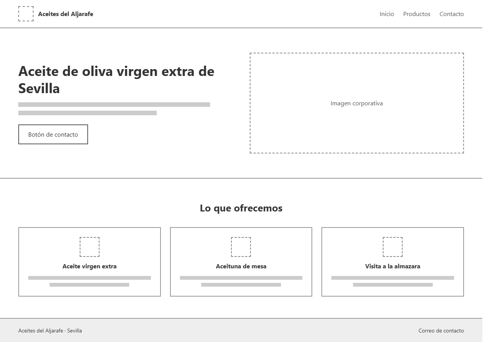
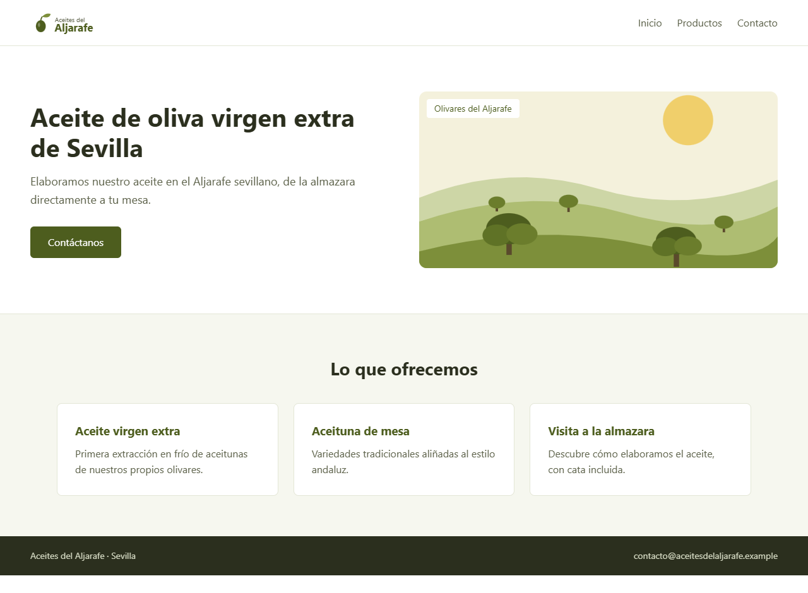

# nginx-static-poc

PoC de infraestructura: landing page estática de **Aceites del Aljarafe** servida por un contenedor **Nginx** con **Docker Compose**.

Realizada por **Guadalquivir Cloud Tech** (consultora) como paso previo a la migración de la plataforma web de su cliente, Aceites del Aljarafe. Módulo 0614 Despliegue de Aplicaciones Web, 2º DAW.

## Contexto

Antes de migrar el back-end y la base de datos del cliente, el equipo de operaciones valida en local que:

- La infraestructura de contenedores funciona (aislamiento y empaquetado frente a una instalación *bare-metal*).
- El mapeo de puertos Host → contenedor es correcto.
- El código se monta con volúmenes de solo lectura y los assets (CSS, imágenes) se sirven bien.
- Los logs de acceso y error salen por los flujos estándar (stdout/stderr).
- Nginx cumple unos mínimos de seguridad: cabeceras HTTP seguras, versión oculta y contenedor aislado.

## Estructura del proyecto

```
AEF-Ngix-DanielOrtizJimenez/
├── README.md
├── img/                          # Diseño y capturas de evidencia
│   ├── Wireframe.png
│   ├── Mockup.png
│   ├── captura1-curl.png
│   ├── captura2-navegador.png
│   └── captura3-logs.png
└── nginx-static-poc/
    ├── conf/
    │   └── default.conf          # Virtual host y hardening de Nginx
    ├── html/
    │   ├── css/style.css
    │   ├── img/                  # logo.svg y olivar.svg
    │   └── index.html
    └── docker-compose.yml
```

## Requisitos

- Windows 11 con Docker Desktop y WSL2 (Ubuntu)
- Visual Studio Code
- Git

## Flujo de puertos

```
 Navegador / curl
        │   http://localhost:8080
        ▼
 Host (Windows 11)  ·  0.0.0.0:8080
        │   mapeo de puertos  "8080:80"
        ▼
 Contenedor srv-nginx-aljarafe  ·  red "red-corp"  ·  puerto 80
        │   server_name aceitesdelaljarafe.local / localhost
        ▼
 /usr/share/nginx/html   ◄── bind mount :ro ──   ./html
```

El primer número de `8080:80` es el puerto del host y el segundo es el del contenedor.

## Ciclo de vida del contenedor

Todos los comandos se ejecutan **desde la carpeta `nginx-static-poc/`**, donde está el `docker-compose.yml`. Si se ejecutan desde otra carpeta, las rutas relativas del compose se rompen.

| Acción | Comando |
|---|---|
| Levantar en segundo plano | `docker compose up -d` |
| Ver estado y puertos | `docker compose ps` |
| Validar el compose | `docker compose config` |
| Comprobar la sintaxis de Nginx | `docker compose exec web nginx -t` |
| Ver logs | `docker compose logs` (en tiempo real: `docker compose logs -f`) |
| Entrar al contenedor | `docker compose exec web sh` |
| Parar y eliminar | `docker compose down` |

## Docker Compose

| Decisión | Motivo |
|---|---|
| `image: nginx:1.27-alpine` | Versión fija en lugar de `latest`, y base Alpine con menos paquetes y menor superficie de ataque. |
| Volúmenes `:ro` (`html/` y `default.conf`) | Si el contenedor es vulnerado, el atacante no puede modificar el HTML, el CSS ni la configuración. |
| `read_only: true` + `tmpfs` | El sistema de archivos del contenedor es de solo lectura. Solo `/var/cache/nginx`, `/var/run` y `/tmp` son escribibles, y en memoria. |
| `security_opt: no-new-privileges` | Impide que un proceso del contenedor gane más privilegios. |
| Red `red-corp` (bridge) | Red propia y aislada en lugar de la red por defecto. |
| `restart: unless-stopped` | El servicio se recupera tras un reinicio, salvo que se pare a mano. |

## Configuración de Nginx y hardening

Archivo: `conf/default.conf`. Se monta en `/etc/nginx/conf.d/default.conf`.

| Medida | Qué hace y por qué |
|---|---|
| `server_tokens off` | Oculta la versión de Nginx (`Server: nginx`). Evita que un atacante busque vulnerabilidades (CVE) de una versión concreta. |
| `X-Frame-Options: DENY` | Impide que otra web cargue esta en un `<iframe>` (clickjacking). |
| `X-Content-Type-Options: nosniff` | Obliga al navegador a respetar el tipo MIME declarado, sin "adivinarlo". |
| `Referrer-Policy: strict-origin-when-cross-origin` | Limita la información de la URL que se envía a otros sitios. |
| `Permissions-Policy` | Desactiva geolocalización, micrófono y cámara, que la web no usa. |
| `Content-Security-Policy` | Solo permite cargar recursos del propio sitio, lo que frena la inyección de scripts. |
| `add_header ... always` | Envía las cabeceras también en las respuestas de error (403, 404). |
| Bloque `default_server` con `return 444` | Cierra la conexión si el `Host` no corresponde al sitio del cliente. Es el enrutamiento por nombre (virtual host). |
| `client_header_timeout`, `client_body_timeout`, `send_timeout`, `keepalive_timeout` | Mitigan ataques lentos tipo Slowloris. |
| `client_max_body_size 1k` y `limit_except GET HEAD` | Es una web estática: no se aceptan subidas ni métodos de escritura. |
| `expires 1h` en archivos estáticos | Caché corta: los cambios de CSS se ven en poco tiempo. |
| `location ~ /\.` con `deny all` | Bloquea archivos ocultos (`.git`, `.env`...). |
| Logs a `/var/log/nginx/*.log` | En la imagen oficial son enlaces a stdout y stderr: no se guarda nada dentro del contenedor y se leen con `docker compose logs`. |

Decisiones conscientes:

- **No se añade `X-XSS-Protection`**: está obsoleto y OWASP recomienda no activarlo.
- **No se añade HSTS**: solo tiene sentido con HTTPS, y esta PoC funciona por HTTP en local.

## Validación

### Captura 1: cabeceras HTTP

```bash
curl.exe -I http://localhost:8080
```

Respuesta `200 OK`, con `Server: nginx` **sin número de versión** y con las cabeceras `X-Frame-Options` y `X-Content-Type-Options` (además de `Referrer-Policy`, `Permissions-Policy` y `Content-Security-Policy`).



### Captura 2: navegador

Acceso a `http://localhost:8080` con las herramientas de desarrollo (F12, pestaña Network, *Disable cache* activado). El HTML (`localhost`), `style.css`, `logo.svg` y `olivar.svg` se cargan con estado **200**. El resto de peticiones de la lista son extensiones del navegador y no pertenecen a la web.



### Captura 3: logs

```bash
docker compose logs
```

Aparece la petición del `curl` (`HEAD /`) y las del navegador (`GET /`, `/css/style.css`, `/img/logo.svg`, `/img/olivar.svg`), todas con 200.



Notas sobre los logs:

- La IP de origen aparece como `172.18.0.1`: es la puerta de enlace de la red Docker, no la IP real del navegador.
- Al arrancar sale un aviso de `10-listen-on-ipv6-by-default.sh` indicando que no puede modificar `default.conf`. Es esperado, porque el archivo está montado en solo lectura, y no afecta al servicio.

## Incidencias

### Puerto 8080 ocupado durante el despliegue

Al ejecutar `docker compose up -d` apareció el error:

```
Bind for 0.0.0.0:8080 failed: port is already allocated
```

**Diagnóstico:** `docker ps` mostró un contenedor antiguo, `servidor-ngix` (`nginx:latest`), publicando el puerto `0.0.0.0:8080->80/tcp`.

**Resolución:** se detuvo ese contenedor con `docker stop servidor-ngix`, se ejecutó `docker compose down` para limpiar el intento fallido y se volvió a levantar con `docker compose up -d`. Alternativa: cambiar el puerto del host en el compose (por ejemplo `8085:80`).

### INC-2026-081: 403 Forbidden / 404 Not Found tras un cambio urgente

_(Pendiente de completar tras reproducir la incidencia: qué cambio se hizo, qué mostraron `docker compose logs -f` y `docker compose exec web sh`, cuál fue la causa —permisos, ruta de `root` o mayúsculas/minúsculas— y cómo se resolvió.)_

## Buenas prácticas aplicadas

- Imagen ligera y con versión fija (`nginx:1.27-alpine`).
- Volúmenes de solo lectura (`:ro`) y contenedor con sistema de archivos de solo lectura.
- Hardening HTTP: versión oculta y cabeceras de seguridad.
- Logs desacoplados: salen por stdout y stderr, sin ficheros dentro del contenedor.
- HTML semántico y CSS externo.
- Infraestructura declarada en `docker-compose.yml` y versionada con Git.

## Wireframe y Mockup



